


 

 

 


 


 

 


<table>
<tr>
<td width="50%" align="center">
<a href="https://github.com/IMPratham001/CampusIq">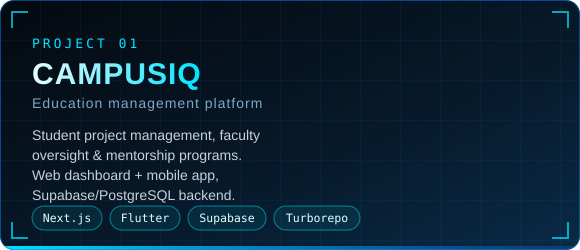</a> 

</td>
<td width="50%" align="center">
<a href="https://github.com/IMPratham001/nutrivault-ecom1">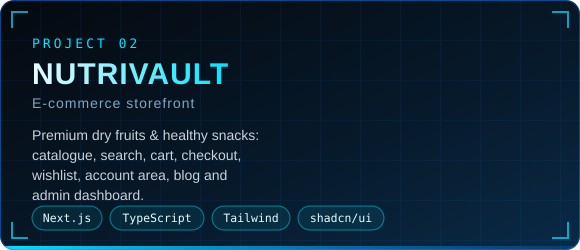</a> 

</td>
</tr>
<tr>
<td width="50%" align="center">
<a href="https://github.com/IMPratham001/Games-Suite">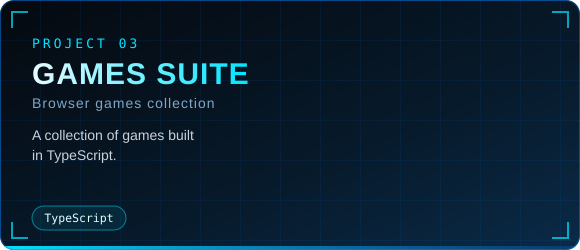</a> 

</td>
<td width="50%" align="center">
<a href="https://github.com/IMPratham001/tomodachi">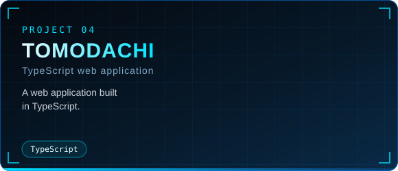</a> 

</td>
</tr>
</table>

 


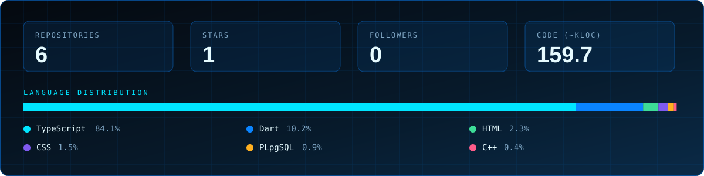

<picture>
  <source media="(prefers-color-scheme: dark)" srcset="https://raw.githubusercontent.com/IMPratham001/IMPratham001/output/github-contribution-grid-snake-dark.svg" />
  <source media="(prefers-color-scheme: light)" srcset="https://raw.githubusercontent.com/IMPratham001/IMPratham001/output/github-contribution-grid-snake.svg" />
  
</picture>

 

<a href="mailto:sonipratham415@gmail.com"></a>
